# OpenTwin

> **Software-Based Automotive CAN Network Emulator & Telemetry Replay Engine**

[](tests/test_pipeline.py)
[](scripts/setup_vcan.sh)
[](frontend_dashboard/)
[](LICENSE)

OpenTwin is a 100% software-based automotive network emulator designed for developing, benchmarking, and verifying digital instrument clusters, diagnostic logic, and ECU cybersecurity applications without requiring physical vehicle hardware or CAN transceivers.

---

## 1. System Architecture & Codebase Data Flow

The following interactive architecture diagram (designed in the **[Archify](https://github.com/tt-a1i/archify)** & **[xyflow](https://github.com/xyflow/xyflow)** node-pipeline specification) showcases the end-to-end data flow: from synthetic drive cycle generation and Linux SocketCAN transport, to the asynchronous DBC decoding backend and the active multi-workspace telemetry suite.

<p align="center">
  
</p>

### Native Codebase Flowchart & Workspace Breakdown

```mermaid
flowchart LR
    %% =========================================================================
    %% ARCHIFY CODEBASE ARCHITECTURE & DATA FLOW
    %% =========================================================================

    classDef fileNode fill:#0b1120,stroke:#38bdf8,stroke-width:1.8px,color:#e2e8f0;
    classDef dbcNode fill:#1e1b4b,stroke:#818cf8,stroke-width:1.8px,color:#e0e7ff;
    classDef transportNode fill:#022c22,stroke:#10b981,stroke-width:2px,color:#a7f3d0;
    classDef backendNode fill:#1c1917,stroke:#f59e0b,stroke-width:2px,color:#fef3c7;
    classDef activeWorkspace fill:#042f2e,stroke:#14b8a6,stroke-width:2.5px,color:#ccfbf1;
    classDef testNode fill:#2e1065,stroke:#c084fc,stroke-width:1.8px,color:#f5f3ff;

    subgraph SOURCES [" 📁 Data Sources & Network Layer "]
        direction TB
        LOG_GEN["🐍 <code>data_logs/generate_logs.py</code><br/>Procedural Drive Cycle Engine"]:::fileNode
        LOG_FILE[("📄 <code>data_logs/sample_drive.log</code><br/>5,100+ Raw candump Frames")]:::fileNode
        VCAN_SCRIPT["📜 <code>scripts/setup_vcan.sh</code><br/>SocketCAN Kernel Setup (vcan0)"]:::fileNode
        REPLAY_SCRIPT["📜 <code>scripts/replay_log.sh</code><br/>canplayer Traffic Injector"]:::fileNode
        
        LOG_GEN -- "Generates timestamped frames" --> LOG_FILE
        VCAN_SCRIPT -- "Initializes interface" --> VCAN_BUS
        LOG_FILE -- "Ingested via canplayer" --> REPLAY_SCRIPT
    end

    subgraph TRANSPORT [" 🔌 Transport Layer (RAM Loopback) "]
        VCAN_BUS["🌐 <b>Linux SocketCAN (vcan0)</b><br/>Virtual CAN Bus Device in Kernel"]:::transportNode
        REPLAY_SCRIPT == "canplayer -I sample_drive.log vcan0=can0" ==> VCAN_BUS
    end

    subgraph BACKEND [" ⚙️ Layer 3: Backend Decoder & Streamer "]
        direction TB
        DBC_DEF[("📖 <code>dbc_definitions/vehicle_base.dbc</code><br/>CAN Matrix (0x100, 0x200, 0x300)")]:::dbcNode
        PY_DECODER["🧠 <code>emulator_core/decoder.py</code><br/>CANDecoder (cantools unpack)"]:::backendNode
        PY_SERVER["⚡ <code>emulator_core/server.py</code><br/>Async WebSocket & HTTP Server"]:::backendNode

        VCAN_BUS == "Raw Hex CAN Frames (50Hz)" ==> PY_DECODER
        DBC_DEF -. "Loads bit layout, scale & offsets" .-> PY_DECODER
        PY_DECODER -- "Physical metrics: RPM, Speed, Temp" --> PY_SERVER
    end

    subgraph FRONTEND [" 🚀 CURRENTLY WORKED AREA: Telemetry Workbench v2.4 PRO "]
        direction TB
        UI_HUB["🌐 <code>frontend_dashboard/index.html</code><br/>Multi-View Glassmorphic Workbench"]:::activeWorkspace
        UI_LOGIC["⚡ <code>frontend_dashboard/app.js</code><br/>WebSocket Client & 60fps Dispatcher"]:::activeWorkspace
        UI_STYLE["🎨 <code>frontend_dashboard/style.css</code><br/>Theme Engine (Comfort, Sport, Eco, Cyber)"]:::activeWorkspace

        W1["🚀 Cockpit Cluster HUD<br/>• Swept Tachometer & Velocity<br/>• Rotating Wheel Chassis HUD<br/>• 4-Wheel TPMS & Alert Rack"]:::activeWorkspace
        W2["📈 60 FPS Signal Oscilloscope<br/>• Multi-Trace Rolling Waveform Plots<br/>• Freeze, Time-Window & Peak Analytics"]:::activeWorkspace
        W3["🔍 CAN Bus Frame Inspector<br/>• Wireshark-Style Byte Highlight<br/>• Live ID Filters & 💾 CSV Export"]:::activeWorkspace
        W4["🕹️ ECU Injector & Fault Panel<br/>• Powertrain Overrides & Presets<br/>• MIL, TPMS, Battery, ABS Faults<br/>• Arbitrary Hex Frame Transmitter"]:::activeWorkspace
        W5["📚 DBC Catalog Browser<br/>• Dynamic Message/Signal Matrix Search"]:::activeWorkspace

        UI_HUB --- UI_LOGIC
        UI_HUB --- UI_STYLE
        UI_LOGIC --> W1
        UI_LOGIC --> W2
        UI_LOGIC --> W3
        UI_LOGIC --> W4
        UI_LOGIC --> W5
    end

    PY_SERVER <== "ws://localhost:8080/ws<br/>[JSON Telemetry Broadcast @ 30Hz]" ==> UI_LOGIC
    W4 -. "Bidirectional Injection: 0x100#... / 0x300#...<br/>[inject_frame action]" .-> PY_SERVER
    PY_SERVER -. "Forwards Injected Frames" .-> VCAN_BUS

    subgraph TESTS [" 🧪 Continuous Verification "]
        TEST_SUITE["🧪 <code>tests/test_pipeline.py</code><br/>6 Unit & Integration Tests (100% Pass)"]:::testNode
        TEST_SUITE -. "Validates DBC, frames, and WS streaming" .-> BACKEND
    end
```



> ⚡ **Active Sprint Focus**: Ongoing work centers on the **Frontend Workbench (`frontend_dashboard/`)** featuring real-time 60 FPS canvas waveform plotting, interactive vehicle chassis kinematics, bidirectional CAN injection, and CSV export.

---

## 2. Core Feature Matrix

| Functional Module | Technology Stack | Capabilities & Scope |
| :--- | :--- | :--- |
| **Virtual Bus Transport** | Linux Kernel `vcan` | In-memory loopback CAN device (`vcan0`) at 500 kbps without hardware transceivers. |
| **Log Ingestion & Replay** | `can-utils` (`canplayer`) | Broadcasts standard `candump` timestamped log files with speed factors (0.5x, 1x, 2x, 5x). |
| **Real-Time DBC Decoder** | `cantools`, `python-can` | Unpacks raw hex payloads into engineering metrics based on `vehicle_base.dbc`. |
| **60 FPS Signal Oscilloscope** | HTML5 Canvas API | High-frequency rolling waveform graph tracking RPM, Velocity, Throttle, and Coolant Temp. |
| **Bidirectional ECU Injector** | WebSocket JSON API | Allows client-side CAN frame injection (`0x100`, `0x200`) and DTC fault simulation (`0x300`). |
| **Frame Stream Inspector** | Vanilla JS / CSS Grid | High-contrast packet monitor with byte-by-byte visual coloring, filters, and CSV export. |
| **Ambient Theme Engine** | CSS3 Custom Properties | 4 dynamic drive modes: **COMFORT** (Cyan), **SPORT** (Red), **ECO** (Emerald), **CYBER** (Violet). |

---

## 3. Formal Deployment Specification

### 3.1. System Prerequisites

| Requirement | Minimum Specification | Recommended Specification |
| :--- | :--- | :--- |
| **Operating System** | Ubuntu 20.04+ / Debian 11+ / WSL2 (Custom Kernel) | Ubuntu 22.04 LTS / 24.04 LTS |
| **Kernel Subsystem** | `CONFIG_CAN=m`, `CONFIG_CAN_VCAN=m` | Native Linux Kernel 5.15+ |
| **Runtime Engine** | Python 3.9+ | Python 3.11+ |
| **System Utilities** | `can-utils`, `net-tools`, `iproute2` | Latest package releases via `apt` |
| **Network Ports** | TCP 8080 (HTTP & WebSocket) | Configurable via `--port` parameter |

```bash
# Install core system dependencies (Debian/Ubuntu)
sudo apt-get update
sudo apt-get install -y can-utils net-tools iproute2 python3 python3-pip python3-venv

# Clone repository & initialize virtual environment
git clone https://github.com/Ravish2807/OpenTwin.git
cd OpenTwin
python3 -m venv venv
source venv/bin/activate
pip install -r emulator_core/requirements.txt
```

---

### 3.2. Production Deployment: Linux Daemon with SocketCAN

#### Step 1: Initialize the Virtual CAN Network Device
```bash
sudo chmod +x scripts/*.sh
sudo ./scripts/setup_vcan.sh
```
*Verification*: Run `ip link show vcan0` to confirm the interface state is `UP`.

#### Step 2: Launch the Decoder & Telemetry Backend
```bash
# Starts backend server on port 8080 binding to vcan0
./scripts/start_backend.sh
```

#### Step 3: Broadcast Recorded Vehicle Log Traffic
In a separate terminal or systemd service:
```bash
./scripts/replay_log.sh data_logs/sample_drive.log vcan0 vcan0
```

#### Step 4: Access the Interactive Dashboard
Navigate to `http://localhost:8080/` (or `http://<SERVER_IP>:8080/`) in any modern web browser.

---

### 3.3. Production Service Orchestration (Systemd Unit)

To run OpenTwin as a persistent, self-healing background system service on a Linux host, create `/etc/systemd/system/opentwin.service`:

```ini
[Unit]
Description=OpenTwin Automotive CAN Emulator & Telemetry Server
After=network.target

[Service]
Type=simple
User=root
WorkingDirectory=/opt/OpenTwin
ExecStartPre=/opt/OpenTwin/scripts/setup_vcan.sh
ExecStart=/opt/OpenTwin/venv/bin/python emulator_core/server.py --dbc dbc_definitions/vehicle_base.dbc --channel vcan0 --bustype socketcan --port 8080
Restart=always
RestartSec=3

[Install]
WantedBy=multi-user.target
```

Enable and start the service:
```bash
sudo systemctl daemon-reload
sudo systemctl enable opentwin
sudo systemctl start opentwin
sudo systemctl status opentwin
```

---

### 3.4. Cross-Platform Standalone Mode (Windows / macOS)

For rapid evaluation environments without native Linux SocketCAN kernel modules, OpenTwin includes a built-in virtual replayer:

```powershell
# Windows PowerShell / Command Prompt
scripts\run_demo.bat
```
```bash
# macOS / Linux (Standalone Virtual Bus)
./scripts/run_demo.sh
```

---

## 4. WebSocket Telemetry & Injection Protocol

The backend exposes a full-duplex WebSocket endpoint at `ws://localhost:8080/ws`.

### Telemetry Packet Broadcast (Server $\rightarrow$ Client @ 30Hz)
```json
{
  "type": "telemetry",
  "data": {
    "EngineSpeed": 3450.0,
    "VehicleSpeed": 88.5,
    "ThrottlePosition": 42.0,
    "EngineTemp": 92.0,
    "OilPressure": 4.2,
    "FuelLevel": 74.0,
    "BatterySOC": 82.0,
    "Gear": "D",
    "BrakeActive": false,
    "TurnSignal": "LEFT",
    "SteeringAngle": -24.5,
    "HeadlightsActive": true,
    "CheckEngineLight": false,
    "BatteryWarning": false,
    "TirePressureWarning": false,
    "ABSWarning": false,
    "Odometer": 14250.4,
    "FPS": 30,
    "TotalFrames": 5100,
    "ReplayPaused": false,
    "ReplaySpeed": 1.0
  },
  "inspector": [
    {
      "timestamp": 1700000010.5,
      "can_id_hex": "0x100",
      "message_name": "Engine_Data",
      "raw_hex": "12B00E582A5C5400",
      "signals": {"EngineSpeed": 3450.0, "VehicleSpeed": 88.5}
    }
  ]
}
```

### Frame Injection Command (Client $\rightarrow$ Server)
```json
{
  "action": "inject_frame",
  "can_id": "0x100",
  "hex_data": "302B000020804400"
}
```

---

## 5. Continuous Verification & Testing

OpenTwin includes an automated unit and integration test suite (`tests/test_pipeline.py`) validating all pipeline stages:

```bash
python tests/test_pipeline.py
```

```
----------------------------------------------------------------------
Ran 6 tests in 2.69s

OK
- test_01_dbc_loading: Validates database structure and signal bit layouts.
- test_02_engine_data_decoding: Asserts bit-packing accuracy for 0x100.
- test_03_vehicle_status_decoding: Validates status flags and steering for 0x200.
- test_04_diagnostics_decoding: Validates DTC fault indicators for 0x300.
- test_05_log_file_integrity: Verifies all 5,100+ frames parse without errors.
- test_06_websocket_telemetry_streaming: Asserts real-time async WebSocket delivery.
```

---

## 6. Repository Structure

```
OpenTwin/
├── data_logs/
│   ├── generate_logs.py         # Procedural drive cycle synthesis engine
│   └── sample_drive.log         # 5,100+ frame realistic candump drive log
├── dbc_definitions/
│   └── vehicle_base.dbc         # Standard CAN database matrix (0x100, 0x200, 0x300)
├── docs/
│   └── architecture_archify.svg # Interactive Archify animated codebase flow
├── emulator_core/
│   ├── decoder.py               # DBC parser & CAN frame decoding engine
│   ├── server.py                # Asynchronous telemetry & WebSocket server
│   └── requirements.txt         # Python dependencies
├── frontend_dashboard/
│   ├── index.html               # Multi-view cluster & workbench layout
│   ├── style.css                # Dark neon glassmorphic UI & themes
│   ├── app.js                   # 60fps oscilloscope & telemetry client
│   └── README.md                # UI feature documentation
├── scripts/
│   ├── setup_vcan.sh            # SocketCAN vcan0 initialization script
│   ├── replay_log.sh            # canplayer automated injection script
│   ├── start_backend.sh         # Linux/WSL2 backend launcher
│   ├── run_demo.bat             # Windows standalone launcher
│   └── run_demo.sh              # Linux standalone launcher
└── tests/
    ├── test_pipeline.py         # Automated test suite
    └── README.md                # Test specification guide
```
