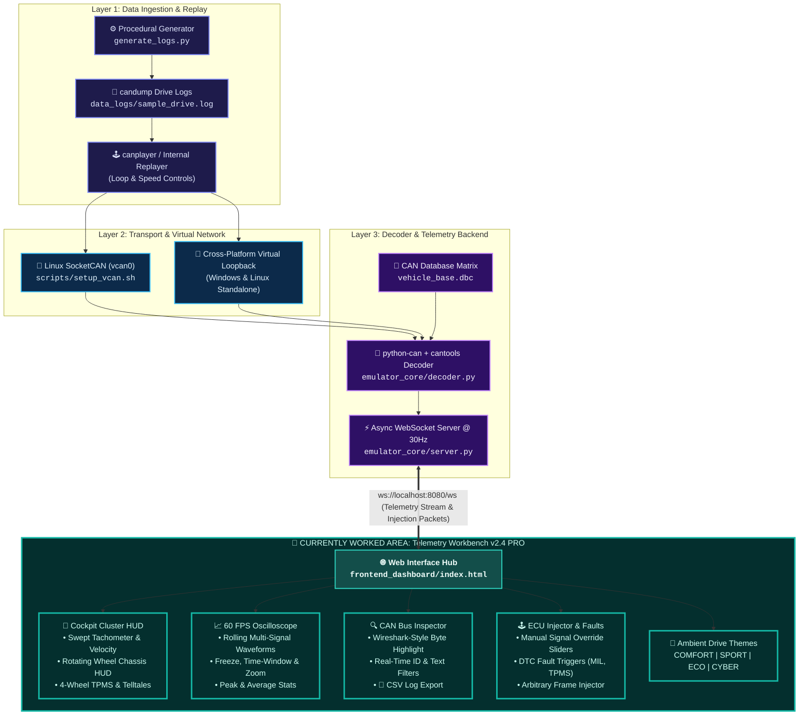

# OpenTwin

> **Software-Based Automotive CAN Network Emulator & Telemetry Replay Engine**

[](tests/test_pipeline.py)
[](scripts/setup_vcan.sh)
[](frontend_dashboard/)
[](LICENSE)

OpenTwin is a 100% software-based automotive network emulator designed for developing and testing digital instrument clusters, diagnostic routines, and ECU cybersecurity logic without requiring physical vehicle hardware or CAN transceivers.

---

## 1. Project Overview & Node Architecture

OpenTwin operates as a **"Ghost Vehicle"** in RAM. The system is architected as a node-based reactive telemetry pipeline (inspired by node workflows like [xyflow/react-flow](https://github.com/xyflow/xyflow)), connecting input logs, virtual bus transport, DBC decoding, bidirectional WebSocket telemetry, and an interactive multi-view cluster workbench.

### Node-Based System Flowchart & Currently Worked Area



> **Current Sprint Focus**: Development is focused on the **Frontend Workbench (`frontend_dashboard/`)** with live 60 FPS canvas waveform plotting, interactive chassis steering kinematics, bidirectional frame injection from the browser, and CSV export.

---

## 2. Core Capabilities

- **Virtual CAN Transport**: Emulates an automotive CAN bus in RAM via Linux SocketCAN (`vcan0`) or cross-platform loopback.
- **Log Injection Engine**: Broadcasts recorded `.log` drive cycles with variable playback speed (0.5x, 1x, 2x, 5x) and looping.
- **Real-Time DBC Decoding**: Translates raw hexadecimal payloads into physical engineering metrics (RPM, Speed, Temperature, Gear, Warnings) using `cantools`.
- **60 FPS Signal Oscilloscope**: Live rolling waveform recorder graphing multi-channel telemetry with peak/average analytics.
- **Bidirectional ECU Injector**: Direct browser-to-bus packet transmission and DTC fault simulation (Check Engine, TPMS, Battery, ABS).
- **Wireshark-Style Inspector**: Live byte-by-byte visual coloring, filtering, bus load estimation, and CSV export.

---

## 3. How to Deploy & Run

### Prerequisites
- Python 3.9+
- Linux / WSL2 with SocketCAN support (or Windows for standalone mode)

```bash
# Clone repository & install dependencies
pip install -r emulator_core/requirements.txt
```

### Option A: Standard Linux / WSL2 Deployment
```bash
# 1. Initialize Virtual CAN interface
sudo ./scripts/setup_vcan.sh

# 2. Start the Decoder & Telemetry Backend
./scripts/start_backend.sh

# 3. In a separate terminal, replay vehicle traffic
./scripts/replay_log.sh data_logs/sample_drive.log

# 4. Open dashboard in your browser
# http://localhost:8080/
```

### Option B: Standalone Quick Start (Any OS)
Run the full system in standalone mode with built-in replayer:
```bash
# Windows
scripts\run_demo.bat

# Linux / macOS
./scripts/run_demo.sh
```

---

## 4. Repository & Module Documentation

For in-depth technical documentation, refer to the module-specific guides:

- 📂 [**`frontend_dashboard/`**](frontend_dashboard/README.md) — Multi-view cluster UI, oscilloscope, ECU injector, and themes.
- 📂 [**`emulator_core/`**](emulator_core/README.md) — Decoder logic, WebSocket API specification, and backend parameters.
- 📂 [**`scripts/`**](scripts/README.md) — Network setup (`vcan0`), `canplayer` replay, and deployment scripts.
- 📂 [**`tests/`**](tests/README.md) — Automated testing pipeline and verification procedures.
- 📂 [**`dbc_definitions/`**](dbc_definitions/vehicle_base.dbc) — CAN database matrix definition file.
- 📂 [**`data_logs/`**](data_logs/) — Vehicle log files and procedural candump log generator.

---

## 5. Verification
Run the automated test suite to verify end-to-end pipeline integrity:
```bash
python tests/test_pipeline.py
```
