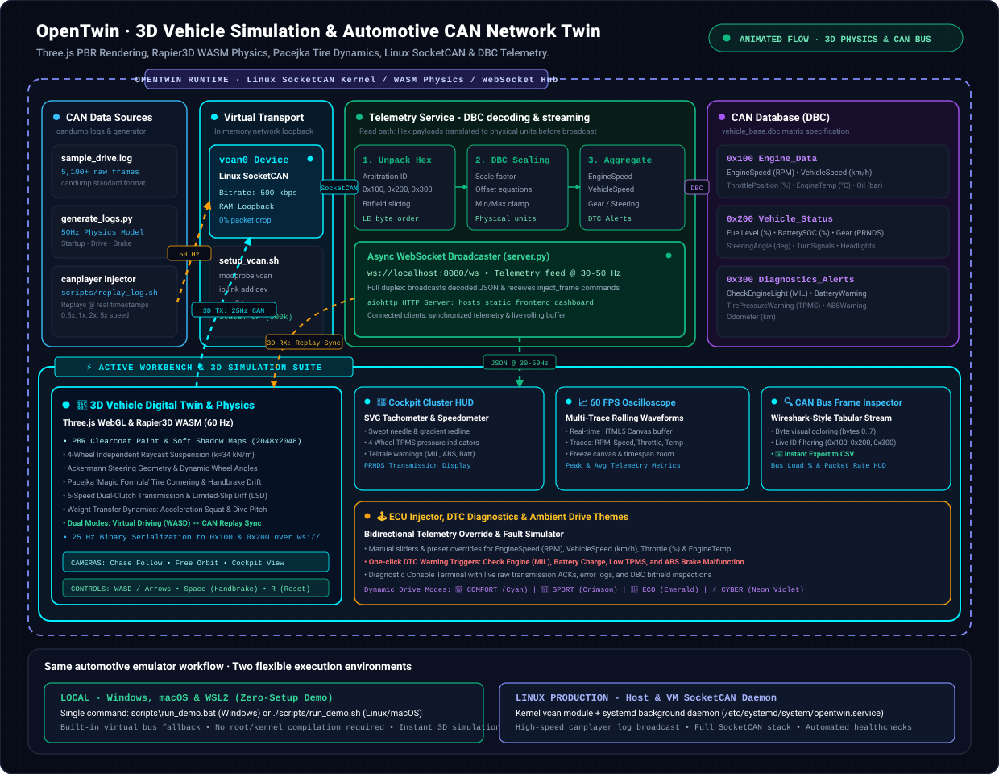

# OpenTwin

> **Software-Based Automotive CAN Network Emulator, Photorealistic 3D Digital Twin & Telemetry Replay Engine**

[](tests/test_pipeline.py)
[](scripts/setup_vcan.sh)
[](frontend_dashboard/sim3d/)
[](frontend_dashboard/)
[](LICENSE)

OpenTwin is a 100% software-based automotive digital twin and network emulator platform. It combines an interactive, photorealistic WebGL/WebAssembly 3D vehicle dynamics simulator with an in-kernel Linux SocketCAN transport, asynchronous DBC decoder, and comprehensive cockpit engineering suite—enabling full-lifecycle vehicle telemetry testing, cluster development, and cybersecurity verification without physical ECUs or hardware transceivers.

---

## 1. System Architecture & Codebase Data Flow

The following interactive architecture diagram (designed in the **[Archify](https://github.com/tt-a1i/archify)** & **[xyflow](https://github.com/xyflow/xyflow)** node-pipeline specification) showcases the end-to-end data flow: from synthetic drive cycles and Linux SocketCAN transport, to the asynchronous DBC decoding backend, 3D physics engine, and the active multi-workspace telemetry suite.

<p align="center">
  
</p>

> ⚡ **Active Sprint Focus**: The **3D Vehicle Simulation Engine (`frontend_dashboard/sim3d/`)** features real-time 60 Hz Rapier3D WASM physics, independent 4-wheel raycast suspension, Ackermann steering geometry, Pacejka 'Magic Formula' tire slip, 6-speed dual-clutch transmission, and bidirectional 25 Hz CAN frame serialization directly onto `vcan0`.

---

## 2. Core Feature Matrix

| Functional Module | Technology Stack | Capabilities & Scope |
| :--- | :--- | :--- |
| **🚗 3D Vehicle Digital Twin** | Three.js (WebGL / WebGPU) | PBR clearcoat lacquer, 2048×2048 PCF soft shadows, multi-cam rig (`Chase`, `Orbit`, `Cockpit`). |
| **🏁 Proving Ground & Test Track** | Procedural Geometry & Colliders | 200m sprint runway with metric distance markers, concentric skid pad ($R=10..50\text{m}$), slalom obstacle course, FIA red/white rumble strips, and Rapier3D physical collision barriers. |
| **💡 Dynamic Lighting & Presets** | Directional & SpotLight Shadows | Dual projector headlights (Off / Low Beam / High Beam) casting real-time 1024×1024 shadows, white reverse backup lamps, and Day / Dusk / Night sky environment presets toggled via <kbd>N</kbd>. |
| **💨 Tire Smoke & Skidmarks** | Particle System & Quad Mesh Pool | Dynamic smoke particle emitter activated during Pacejka tire slip, buoyant lift, and persistent asphalt rubber skidmarks with FIFO quad strip recycling. |
| **⚙️ WASM Physics & Suspension** | Rapier3D (`@dimforge/rapier3d-compat`) | 60 Hz deterministic physics, 4-wheel independent raycast suspension ($k=34\text{ kN/m}$, $c=4.4\text{ kN}\cdot\text{s/m}$), and ground collision plane. |
| **🏎️ Steering & Tire Dynamics** | Analytical Ackermann & Pacejka | Unequal inner/outer wheel steering ($\delta_{\text{inner}} \neq \delta_{\text{outer}}$), Pacejka Magic Formula tire friction curves, friction circle clamping, and handbrake drift. |
| **⚡ Powertrain & Weight Transfer** | Kinematic Drivetrain Model | Non-linear engine torque curve (220–480 Nm), idle governor (850 RPM), 7200 RPM fuel-cut bounce, 6-speed DCT gearbox, limited-slip differential (LSD), and acceleration squat / braking dive. |
| **📡 Bidirectional CAN Bridge** | WebSocket JSON API / Binary DBC | Real-time 25 Hz binary serialization (`0x100 Engine_Data`, `0x200 Vehicle_Status`) from 3D driving into `vcan0` + Replay Sync mode animating 3D vehicle from CAN logs. |
| **Virtual Bus Transport** | Linux Kernel `vcan` | In-memory loopback CAN device (`vcan0`) at 500 kbps without hardware transceivers. |
| **Log Ingestion & Replay** | `can-utils` (`canplayer`) | Broadcasts standard `candump` timestamped log files with speed factors (0.5x, 1x, 2x, 5x). |
| **Real-Time DBC Decoder** | `cantools`, `python-can` | Unpacks raw hex payloads into engineering metrics based on `vehicle_base.dbc`. |
| **60 FPS Signal Oscilloscope** | HTML5 Canvas API | High-frequency rolling waveform graph tracking RPM, Velocity, Throttle, and Coolant Temp. |
| **Frame Stream Inspector** | Vanilla JS / CSS Grid | High-contrast packet monitor with byte-by-byte visual coloring, filters, and CSV export. |
| **Ambient Theme Engine** | CSS3 Custom Properties | 4 dynamic drive modes: **COMFORT** (Cyan), **SPORT** (Red), **ECO** (Emerald), **CYBER** (Violet). |

---

## 3. Real-Time 3D Simulation Controls

When viewing the **🚗 3D Digital Twin** tab, you can drive the car interactively in real time:

| Control | Key Binding | Dynamic Effect |
| :--- | :---: | :--- |
| **Throttle / Drive** | <kbd>W</kbd> or <kbd>↑</kbd> | Drives rear wheels via LSD, revs engine RPM, and upshifts 1st through 6th gear |
| **Brake / Reverse** | <kbd>S</kbd> or <kbd>↓</kbd> | Illuminates rear LED brake bar, induces nose dive pitch, decelerates, and engages Reverse |
| **Steer Left / Right** | <kbd>A</kbd> / <kbd>D</kbd> or <kbd>←</kbd> / <kbd>→</kbd> | Applies Ackermann unequal angle geometry to front wheels and creates centrifugal body roll |
| **Handbrake Drift** | <kbd>Space</kbd> | Locks rear wheels, breaks Pacejka lateral tire adhesion into a controlled power slide |
| **Headlights Toggle** | <kbd>L</kbd> | Cycles dual projector headlights (Off → Low Beam → High Beam) with real-time shadow casting |
| **Day / Night Preset** | <kbd>N</kbd> | Cycles ambient environment presets (Day → Dusk → Night) adjusting sky color, sun angles, and fog |
| **Reset Vehicle** | <kbd>R</kbd> | Instantly resets the vehicle translation and orientation back to the starting grid $(0, 0.75, 0)$ |
| **Operating Mode** | Header Button | Toggles between **🎮 Virtual Drive (WASD)** (3D $\rightarrow$ CAN) and **📡 CAN Replay Sync Mode** (CAN $\rightarrow$ 3D) |
| **Camera Views** | Header Pills | Switch between **🎥 Chase Cam**, **🔄 Free Orbit**, and **🏎️ Cockpit Cam** |

---

## 4. Formal Deployment Specification

### 4.1. System Prerequisites

| Requirement | Minimum Specification | Recommended Specification |
| :--- | :--- | :--- |
| **Operating System** | Ubuntu 20.04+ / Debian 11+ / WSL2 (Custom Kernel) | Ubuntu 22.04 LTS / 24.04 LTS / Windows 10/11 |
| **Kernel Subsystem** | `CONFIG_CAN=m`, `CONFIG_CAN_VCAN=m` | Native Linux Kernel 5.15+ (or standalone demo mode) |
| **Runtime Engine** | Python 3.9+ | Python 3.11+ / 3.12+ / 3.13+ |
| **System Utilities** | `can-utils`, `net-tools`, `iproute2` | Latest package releases via `apt` |
| **Network Ports** | TCP 8080 (HTTP & WebSocket) | Configurable via `--port` parameter |

```bash
# Install core system dependencies (Debian/Ubuntu)
sudo apt-get update
sudo apt-get install -y can-utils net-tools iproute2 python3 python3-pip python3-venv

# Clone repository & initialize virtual environment
git clone https://github.com/Ravish2807/OpenTwin.git
cd OpenTwin
python3 -m venv venv
source venv/bin/activate
pip install -r emulator_core/requirements.txt
```

---

### 4.2. Local Zero-Setup Testing (Windows / macOS / Linux)

For rapid evaluation without requiring root privileges or physical CAN hardware:

```powershell
# Windows PowerShell / Command Prompt
scripts\run_demo.bat
```

```bash
# macOS / Linux (Standalone Virtual Bus)
./scripts/run_demo.sh
```

Or run directly via Python:
```bash
python emulator_core/server.py --dbc dbc_definitions/vehicle_base.dbc --replay-log data_logs/sample_drive.log --port 8080
```

Navigate to **`http://localhost:8080/`** in Chrome, Edge, or Brave and click on **🚗 3D Digital Twin**.

---

### 4.3. Production Deployment: Linux Daemon with SocketCAN

#### Step 1: Initialize the Virtual CAN Network Device
```bash
sudo chmod +x scripts/*.sh
sudo ./scripts/setup_vcan.sh
```
*Verification*: Run `ip link show vcan0` to confirm the interface state is `UP`.

#### Step 2: Launch the Decoder & Telemetry Backend
```bash
# Starts backend server on port 8080 binding to vcan0
./scripts/start_backend.sh
```

#### Step 3: Broadcast Recorded Vehicle Log Traffic
In a separate terminal or systemd service:
```bash
./scripts/replay_log.sh data_logs/sample_drive.log vcan0 vcan0
```

#### Step 4: Access the Interactive Dashboard
Navigate to `http://localhost:8080/` (or `http://<SERVER_IP>:8080/`) in any modern web browser.

---

### 4.4. Production Service Orchestration (Systemd Unit)

To run OpenTwin as a persistent, self-healing background system service on a Linux host, create `/etc/systemd/system/opentwin.service`:

```ini
[Unit]
Description=OpenTwin Automotive CAN Emulator & Telemetry Server
After=network.target

[Service]
Type=simple
User=root
WorkingDirectory=/opt/OpenTwin
ExecStartPre=/opt/OpenTwin/scripts/setup_vcan.sh
ExecStart=/opt/OpenTwin/venv/bin/python emulator_core/server.py --dbc dbc_definitions/vehicle_base.dbc --channel vcan0 --bustype socketcan --port 8080
Restart=always
RestartSec=3

[Install]
WantedBy=multi-user.target
```

Enable and start the service:
```bash
sudo systemctl daemon-reload
sudo systemctl enable opentwin
sudo systemctl start opentwin
sudo systemctl status opentwin
```

---

## 5. WebSocket Telemetry & Injection Protocol

The backend exposes a full-duplex WebSocket endpoint at `ws://localhost:8080/ws`.

### Telemetry Packet Broadcast (Server $\rightarrow$ Client @ 30–50Hz)
```json
{
  "type": "telemetry",
  "data": {
    "EngineSpeed": 3450.0,
    "VehicleSpeed": 88.5,
    "ThrottlePosition": 42.0,
    "EngineTemp": 92.0,
    "OilPressure": 4.2,
    "FuelLevel": 74.0,
    "BatterySOC": 82.0,
    "Gear": "D",
    "BrakeActive": false,
    "TurnSignal": "LEFT",
    "SteeringAngle": -24.5,
    "HeadlightsActive": true,
    "CheckEngineLight": false,
    "BatteryWarning": false,
    "TirePressureWarning": false,
    "ABSWarning": false,
    "Odometer": 14250.4,
    "FPS": 60,
    "TotalFrames": 5100,
    "ReplayPaused": false,
    "ReplaySpeed": 1.0
  }
}
```

### 3D Simulator CAN Injection Command (Client $\rightarrow$ Server @ 25Hz)
```json
{
  "action": "inject_frame",
  "can_id": "0x100",
  "hex_data": "302B000020804400"
}
```

---

## 6. Continuous Verification & Testing

OpenTwin includes an automated unit and integration test suite (`tests/test_pipeline.py`) validating all pipeline stages:

```bash
python tests/test_pipeline.py
```

```
----------------------------------------------------------------------
Ran 6 tests in 2.68s

OK
- test_01_dbc_loading: Validates database structure and signal bit layouts.
- test_02_engine_data_decoding: Asserts bit-packing accuracy for 0x100.
- test_03_vehicle_status_decoding: Validates status flags and steering for 0x200.
- test_04_diagnostics_decoding: Validates DTC fault indicators for 0x300.
- test_05_log_file_integrity: Verifies all 5,100+ frames parse without errors.
- test_06_websocket_telemetry_streaming: Asserts real-time async WebSocket delivery.
```

---

## 7. Repository Structure

```
OpenTwin/
├── data_logs/
│   ├── generate_logs.py         # Procedural drive cycle synthesis engine
│   └── sample_drive.log         # 5,100+ frame realistic candump drive log
├── dbc_definitions/
│   └── vehicle_base.dbc         # Standard CAN database matrix (0x100, 0x200, 0x300)
├── docs/
│   └── architecture_flow.svg    # ActionCloud/Archify animated architecture flow
├── emulator_core/
│   ├── decoder.py               # DBC parser & CAN frame decoding engine
│   ├── server.py                # Asynchronous telemetry & WebSocket server
│   └── requirements.txt         # Python dependencies
├── frontend_dashboard/
│   ├── index.html               # Multi-view cluster, 3D viewport & workbench layout
│   ├── style.css                # Dark neon glassmorphic UI, HUD & themes
│   ├── app.js                   # WebSocket bridge, oscilloscope & cluster telemetry client
│   └── sim3d/                   # 3D Vehicle Simulation Engine
│       ├── engine.js            # Three.js WebGL viewport & camera mode controller
│       ├── environment.js       # Sun lighting rig, 2048x2048 soft shadows & proving ground
│       ├── vehicle.js           # Rigged PBR vehicle model, wheel assemblies & lighting
│       ├── physics.js           # Rapier3D WASM, raycast suspension, Ackermann & Pacejka
│       ├── drivetrain.js        # Engine torque curve, 6-speed DCT gearbox & LSD
│       ├── controls.js          # Interactive WASD driving input controller
│       ├── effects.js           # Dynamic tire smoke particle emitter & persistent skidmark quad pool
│       └── can_bridge.js        # 25Hz binary CAN serialization & replay synchronization
├── scripts/
│   ├── setup_vcan.sh            # SocketCAN vcan0 initialization script
│   ├── replay_log.sh            # canplayer automated injection script
│   ├── start_backend.sh         # Linux/WSL2 backend launcher
│   ├── run_demo.bat             # Windows standalone launcher
│   └── run_demo.sh              # Linux standalone launcher
└── tests/
    ├── test_pipeline.py         # Automated test suite
    └── README.md                # Test specification guide
```
